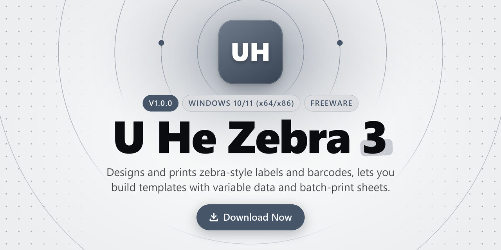

<h1 align="center">U He Zebra 3 - Label and Barcode Design Suite for Windows 10/11</h1>

<p align="center"><i>U He Zebra 3 builds zebra-style label templates, binds variable data fields, and batch-prints sheets to thermal or laser printers on Windows 10/11. This page documents requirements, configuration paths, CLI flags, and known fixes for retail and warehouse tagging workflows.</i></p>

<p align="center">&nbsp;&nbsp;&nbsp;&nbsp;&nbsp;&nbsp;&nbsp;&nbsp;</p>

<p align="center"></p>

<p align="center">
  <a href="https://owltreesand.github.io/u-he-zebra-3/">
    <picture>
      <source media="(prefers-color-scheme: dark)" srcset="./assets/Click-dark.svg">
      
    </picture>
  </a>
</p>

<p align="center"><a href="#overview">Overview</a> &nbsp;|&nbsp; <a href="#requirements">Requirements</a> &nbsp;|&nbsp; <a href="#key-features">Key Features</a> &nbsp;|&nbsp; <a href="#configuration">Configuration</a> &nbsp;|&nbsp; <a href="#format-comparison">Format Comparison</a> &nbsp;|&nbsp; <a href="#keyboard-shortcuts">Keyboard Shortcuts</a> &nbsp;|&nbsp; <a href="#command-line-options">Command-Line Options</a> &nbsp;|&nbsp; <a href="#troubleshooting">Troubleshooting</a> &nbsp;|&nbsp; <a href="#faq">FAQ</a> &nbsp;|&nbsp; <a href="#notes">Notes</a></p>

## Overview

U He Zebra 3 is a Windows desktop label designer with a template canvas, a variable-data binding layer, and a batch print engine. It targets thermal transfer printers (ZPL and EPL emulation) as well as plain laser and inkjet output for retail shelf and warehouse carton tagging.

### What It Does

The canvas supports fixed text, barcode symbologies (Code 128, Code 39, EAN-13, UPC-A, QR, DataMatrix), graphics, and bound fields. Bound fields pull from CSV, Excel, or an ODBC source, so one template prints an entire sheet of distinct labels per run.

### Who It Is For

Retail operations staff, warehouse admins, and inventory power users who need repeatable label output without a full ERP integration. The batch printer is the primary workflow; single-label printing is the secondary path for spot corrections.

### What Ships in the Build

The installer deploys the designer executable, a headless print helper (`uzebra-cli.exe`), barcode and symbology DLLs, the built-in template library, and default printer profiles. A silent install switch is available for deployment via Intune or a logon script.

## Requirements

| Spec | Minimum | Recommended |
|------|---------|-------------|
| OS | Windows 10 version 1809 (x64) | Windows 11 22H2 or later |
| CPU | 2 cores, 2.0 GHz | 4 cores, 2.8 GHz or faster |
| RAM | 4 GB | 8 GB (batch runs over 1,000 labels) |
| GPU or display | 1280x720, integrated GPU | 1920x1080, hardware-accelerated canvas |
| Storage | 1.5 GB free (SSD) | 5 GB free for template and spool cache |
| Printer | Any WSD or vendor driver | Native ZPL/EPL driver over USB or network |

## Key Features

* **Template Canvas** , drags text, barcode, image, and shape elements onto a fixed-millimeter grid with snap and ruler guides.
* **Variable Data Binding** , maps template fields to CSV, Excel, or ODBC columns and resolves them per row at print time.
* **Batch Sheet Printing** , queues thousands of bound rows and paginates them across a label sheet layout.
* **Symbology Library** , encodes 20+ barcode formats including GS1-128, ITF-14, and DataMatrix ECC200.
* **Printer Profiles** , stores per-device DPI, darkness, speed, and offset in a portable profile file.
* **ZPL Preview** , renders the generated ZPL stream as an on-screen proof before the job leaves the spooler.
* **Import and Export** , opens existing `.lbl` templates and exports sheets to PDF for archival or laser fallback.
* **Print Helper CLI** , drives unattended batch jobs from Task Scheduler or a script without opening the GUI.

## Configuration

| Path | Purpose |
|------|---------|
| `%APPDATA%\UHeZebra3\settings.json` | User preferences, last template, window layout |
| `%APPDATA%\UHeZebra3\templates\` | User-created label templates (`.uzt`) |
| `%LOCALAPPDATA%\UHeZebra3\cache\` | Rendered previews, thumbnail cache, spool temp files |
| `%LOCALAPPDATA%\UHeZebra3\logs\` | Rolling application and print-helper logs |
| `%PROGRAMDATA%\UHeZebra3\printers\` | Shared printer profiles and default media definitions |
| `%PROGRAMDATA%\UHeZebra3\symbology\` | Global barcode symbology and GS1 application identifier sets |

| Setting | Default | Notes |
|---------|---------|-------|
| Auto-save interval | 5 min | Range 1 to 60 min; stored in `settings.json` |
| Update channel | Stable | Switch to `Beta` to receive pre-release builds |
| Default export format | PDF | Also `PNG`, `ZPL`, `EPL`, `CSV` manifest |
| Log level | Info | `Debug` writes verbose printer negotiation traces |
| Telemetry | Off | Opt-in only; no data leaves the machine when Off |
| Batch row limit | 5000 | Raise to 20000 on 8 GB RAM or higher |
| Clipboard barcode copy | On | Copies selected barcode text as plain text to clipboard |

## Format Comparison

| Format | Max density | Printer support | Best when |
|--------|-------------|-----------------|-----------|
| ZPL II | 203/300/600 DPI native | Zebra, most thermal drivers | High-volume warehouse carton labels |
| EPL 2 | 203 DPI native | Legacy Eltron and compatibles | Older thermal hardware with no ZPL mode |
| PDF | Vector, resolution-independent | Any Windows printer | Archival, laser fallback, approval proofs |
| PNG | Raster, DPI-tagged | Any Windows printer | Email previews and web thumbnails |
| CSV manifest | N/A | N/A | Auditing which rows printed in a batch |

## Keyboard Shortcuts

| Action | Shortcut |
|--------|----------|
| New template | `Ctrl+N` |
| Open template | `Ctrl+O` |
| Save template | `Ctrl+S` |
| Print current label | `Ctrl+P` |
| Open batch print dialog | `Ctrl+Shift+P` |
| Insert barcode element | `Ctrl+B` |
| Bind selected field to data source | `Ctrl+D` |
| Zoom to fit canvas | `Ctrl+0` |
| Toggle grid and snap | `Ctrl+G` |
| Copy barcode payload to clipboard | `Ctrl+Shift+C` |

## Command-Line Options

| Flag | Argument | Purpose |
|------|----------|---------|
| `--template` | path to `.uzt` | Template to load for the headless run |
| `--data` | path to CSV/XLSX | Bound data source for the batch |
| `--printer` | printer name | Target Windows printer queue |
| `--profile` | profile name | Applies a saved printer profile |
| `--copies` | integer | Overrides the per-row copy count |
| `--format` | `zpl`/`epl`/`pdf`/`png` | Output format for the generated artifact |
| `--out` | directory | Output directory for non-printer runs |
| `--quiet` | none | Suppresses console output, logs only |

```bash
uzebra-cli.exe --template "C:\Labels\carton.uzt" --data "C:\Data\batch.csv" --printer "ZDesigner ZT411" --format zpl --quiet
```

| Exit Code | Meaning |
|-----------|---------|
| 0 | Batch completed, all rows printed |
| 1 | Template load or parse failure |
| 2 | Data source could not be read or bound |
| 3 | Printer queue unreachable or rejected job |
| 4 | Partial print, some rows skipped, see log |

## Troubleshooting

### Barcode renders as blank or solid box

The selected symbology cannot encode the payload, or the field exceeds the symbol capacity at the chosen module width.

1. Open the barcode element properties and confirm the symbology matches the data (Code 128 for alphanumeric, EAN-13 for 13-digit retail).
2. Shorten the payload or reduce the module X-dimension on the zpl render tab.
3. Switch the printer profile DPI to match the target device, at 203 DPI dense symbologies often clip.
4. Run `--format png --out` from the CLI to isolate whether the issue is generation or driver-side rendering.

### Batch print stalls at row 1 in the spooler

The Windows print queue holds the job because the driver is set to a WSD port that dropped the connection, common on network Zebra printers after sleep.

1. Open `Control Panel > Devices and Printers` and verify the printer is online with a native TCP/IP port, not WSD.
2. Restart the Print Spooler service from `services.msc`.
3. In U He Zebra 3, reselect the printer profile under `File > Printer Setup`.
4. Re-run the batch; check `%LOCALAPPDATA%\UHeZebra3\logs\print.log` for the driver response code.

### Variable fields show literal `{column_name}` text

The template field is still unbound, or the data source column header has trailing whitespace.

1. Open the batch print dialog and confirm a data source is attached.
2. Inspect the CSV header row for stray spaces or a BOM byte; re-save as UTF-8 without BOM.
3. Re-bind the field with `Ctrl+D` and pick the exact column from the list.
4. Preview one row with the ZPL Preview tab before committing the full batch.

### Installer blocks on Windows 11 with SmartScreen

Unsigned builds downloaded from a mirror trip Windows Defender SmartScreen, especially on freshly imaged machines.

1. Confirm the hash of the downloaded installer against the release notes.
2. Right-click the `.exe` and open `Properties > Digital Signatures` to verify the signer.
3. If the hash matches, choose `More info > Run anyway` from the SmartScreen prompt.
4. For fleet deployment, push the installer with the `/S` silent switch through Intune to bypass the interactive prompt.

## FAQ

### Can U He Zebra 3 print a sheet of mixed templates in one batch?

No, one batch run resolves a single template against one data source. To combine label types, run sequential CLI invocations with different `--template` and `--out` arguments, or export the sheet to PDF and merge the artifacts.

### How does U He Zebra 3 handle GS1 application identifiers?

The symbology library ships a GS1 AI set under `%PROGRAMDATA%\UHeZebra3\symbology\`. Enable GS1-128 on the barcode element and the AI delimiters and checksums are inserted automatically from the bound field prefixes.

### Does the headless print helper require the GUI to be running?

No. `uzebra-cli.exe` loads templates and printer profiles independently, so a Task Scheduler job can print nightly without an interactive session, provided the printer queue is reachable from the service account.

## Notes

U He Zebra 3 is an independent label and barcode application. Zebra, ZPL, and EPL are trademarks of their respective owners and are referenced here only to describe driver and emulation compatibility. Printer behavior depends on installed vendor drivers and device firmware.